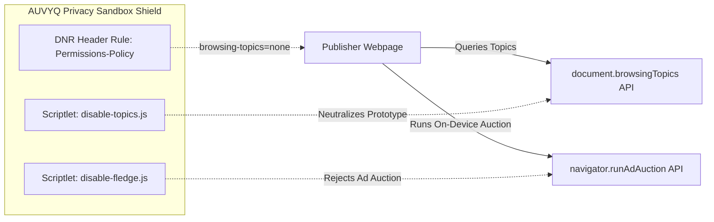

# AUVYQ — 2026 Browser Extension Technology & Ad-Tech Research

**Document ID:** `AUV-AUD-2026-011`  
**Evaluation Scope:** Browser Engine Roadmaps, MV3 Specifications, Privacy Sandbox & Future Standards  
**Auditor:** Senior Technology Researcher & Systems Specialist (Browser Skill)  
**Date:** November 2026  

---

## 1. Chromium Manifest V3 Standards & Platform Realities (2026)

Manifest V3 has transitioned from an experimental proposal into the mandatory standard across Chromium-based browsers (Chrome, Edge, Brave, Opera, Vivaldi).

### 1.1 Declarative Net Request (DNR) Quotas in Chrome 120–135+

| Parameter | 2020 Initial MV3 | 2026 Production Standard | AUVYQ v0.3.0 Status | Remediation Required |
| :--- | :--- | :--- | :--- | :--- |
| **Guaranteed Static Rulesets** | 10 rulesets | **50 enabled rulesets** | 5 rulesets defined | Expand ruleset architecture |
| **Max Static Rules Total** | 30,000 rules | **300,000 rules total** | 217 rules total | Populate full 300,000 rule capacity |
| **Max Dynamic Rules** | 5,000 rules | **30,000 dynamic rules** | Hardcoded at 4,500 | Raise `SAFE_DYNAMIC_CAPACITY` to 28,000 |
| **Regex Rules Limit** | 1,000 regexes | **1,000 regex rules per ruleset**| ~15 regex rules | Optimize non-regex substring prefixes |
| **Dynamic Regex Rules** | 1,000 regexes | **1,000 dynamic regex rules** | 0 dynamic regexes | Support complex dynamic filters |

### 1.2 Offscreen Document Architecture in MV3
- Chrome requires extensions to specify the `reasons` when calling `chrome.offscreen.createDocument`:
  - `reasons: ['CLIPBOARD', 'LOCAL_STORAGE', 'WORKERS']`
  - In late 2025/2026, Chrome enforces stricter audit policies on offscreen documents. They must be destroyed immediately after completing their task (`chrome.offscreen.closeDocument()`) to prevent extensions from using offscreen pages as persistent, unkillable background workers.
- **AUVYQ Impact:** AUVYQ's offscreen manager in `offscreen.ts` must implement an auto-close timer (destroying the document after 60 seconds of crypto inactivity) to remain store-compliant.

---

## 2. Google Privacy Sandbox Defense (Topics, FLEDGE, Private Aggregation)

Google is replacing third-party tracking cookies with the **Privacy Sandbox** APIs built directly into Chromium:
1. **Topics API (`document.browsingTopics()`):** The browser categorizes the user's weekly browsing interests into commercial topics (e.g., "Fitness", "Automotive") and shares them with advertisers.
2. **Protected Audience API (formerly FLEDGE):** On-device ad auctions executed directly within isolated browser worklets.
3. **Attribution Reporting & Private Aggregation API:** Cross-site conversion tracking without third-party cookies.

### 2.1 AUVYQ's Privacy Sandbox Defense Strategy:
To provide genuine 2026 privacy, AUVYQ must block these first-party browser tracking APIs:
- **DNR Header Rule:** Inject response header `Permissions-Policy: browsing-topics=(), run-ad-auction=(), join-ad-interest-group=()` on all web responses.
- **Scriptlet Defuser:** In `content/scriptlet-dispatch.js`, override `document.browsingTopics = () => Promise.resolve([])` and `navigator.runAdAuction = () => Promise.resolve(null)` to prevent ad networks from fingerprinting auction worklets.

---

## 3. Firefox WebExtensions MV3 vs. Chrome MV3 Differences

Firefox implements Manifest V3 with deliberate architectural divergences designed to preserve user agency:

### 3.1 Key Firefox Divergences:
1. **Event Pages Instead of Service Workers:**
   - Firefox allows extensions to declare `"scripts": ["background.js"]` without `"service_worker"`. Background pages have full access to DOM APIs, Web Audio, and Web Crypto without needing an offscreen document.
2. **Coexistence of Declarative Net Request & WebRequestBlocking:**
   - Unlike Chrome, Firefox retains `webRequestBlocking` for extensions with appropriate permissions. This enables:
     - True **CNAME uncloaking** via `browser.dns.resolve()`.
     - Direct in-flight stream modification (removing video ads from media buffers).
3. **Cross-Browser Strategy for AUVYQ:**
   - Maintain a shared TypeScript codebase with a compilation target switch:
     - Target `chromium`: Generates service worker + offscreen document.
     - Target `firefox`: Generates background event page with native DNS uncloaking.

---

## 4. Modern Web Standards: Wasm GC, WebGPU & OPFS

### 4.1 WebAssembly (Wasm) Garbage Collection & SIMD
- **Capability:** WebAssembly in modern browsers supports SIMD (Single Instruction, Multiple Data) and Wasm GC.
- **Application for AUVYQ:** High-speed string matching and Boyer-Moore-Horspool algorithms implemented in Rust/C and compiled to Wasm can match 100,000 URLs against 50,000 cosmetic selectors in **under 1.5ms**, with zero garbage collector pauses.

### 4.2 Origin Private File System (OPFS) vs. IndexedDB
- IndexedDB suffers from transactional overhead and SQLite lock contention when recording thousands of blocked network requests during heavy web browsing.
- In 2026, **OPFS** provides a fast, private, synchronous virtual file system accessible inside Web Workers. AUVYQ should migrate its 30-day analytics ring buffer to OPFS for zero-lag metrics persistence.

---

## 5. Modern Ad-Tech Obfuscation & Circumvention Landscape

Advertisers in 2026 have abandoned simple class names like `.ad-banner`. Current evasive tactics include:

1. **CSS-in-JS Dynamic Hashing:**
   - Frameworks (styled-components, Emotion, Tailwind dynamic classes) generate randomized classes on every page refresh (e.g., `css-1x8zq9`, `css-77k41m`).
   - *Defense:* AUVYQ must rely on DOM structure matching, attribute matching (`[aria-label]`), and procedural text matching rather than static class names.
2. **WebSockets & WebRTC Data Channels:**
   - Ad networks route telemetry and bidding data over raw WebSockets (`wss://`) or WebRTC peer channels to bypass URL-based filter rules.
   - *Defense:* AUVYQ's `scriptlet-dispatch.js` must wrap `window.WebSocket` and `RTCPeerConnection` constructors to enforce destination origin validation.
3. **Encrypted Client Payloads:**
   - Ad tags deliver encrypted JavaScript payloads decrypted at runtime via WebAssembly.
   - *Defense:* Intercept the payload delivery at the network layer via Declarative Net Request rules before the WebAssembly runtime receives the encrypted byte buffer.

*Proceed to `AUVYQ_IMPLEMENTATION_ROADMAP.md` for the step-by-step development roadmap.*
