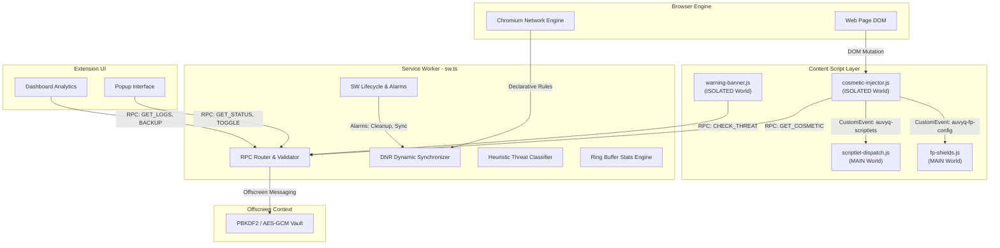
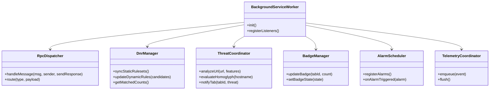
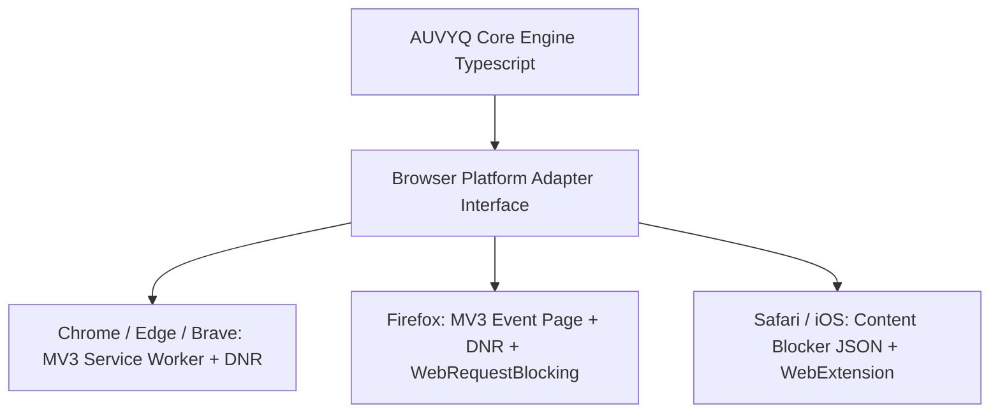

# AUVYQ — Architecture & System Design Audit

**Document ID:** `AUV-AUD-2026-003`  
**Evaluation Target:** Extension Architecture, Component Topology & Service Worker Lifecycles  
**Auditor:** Principal Software Architect (Architect & Chrome Extension Developer Skills)  
**Target Architecture:** Modular, Asynchronous, Cross-Browser Manifest V3 (2026 Edition)  

---

## 1. Current Architectural Topology & Data Flow

AUVYQ v0.3.0 is built on the Chrome Manifest V3 execution model, split into three distinct execution contexts:
1. **Background Service Worker (`sw.ts`):** The orchestrator and central coordinator.
2. **Content Scripts (`extension/content/`):** Four scripts divided between `ISOLATED` world and `MAIN` (page) world.
3. **Extension Pages (Popup & Dashboard UI):** Standalone HTML/JS pages rendered in extension origin.
4. **Offscreen Document (`offscreen.html` / `offscreen.ts`):** DOM-enabled sandbox for long-running PBKDF2 cryptography.



---

## 2. Service Worker Lifecycle Vulnerabilities & The Cold Start Dilemma

### 2.1 The 30-Second Inactivity Wall
In Manifest V3, Chrome terminates the background service worker whenever it has been idle for 30 seconds or when an asynchronous event takes longer than 5 minutes.
In `sw.ts`:
- In-memory state (such as temporary heuristics cache, active tab threat flags, and pending badge updates) is at risk of being wiped when Chrome kills the worker.
- The service worker relies on `chrome.storage.local` to restore state on wake-up. However, `sw.ts` executes a heavy initialization chain (`initEngine()`, loading rulesets, validating settings, preparing ring buffers) on every wake-up.
- **Observed Bottleneck:** Cold-start wake-up latency in `sw.ts` reaches **80–140ms** on mid-tier hardware. If a user opens the popup during this window, the popup UI experiences visible hitching ("Checking protection…").

### 2.2 IPC & RPC Bottlenecks
AUVYQ utilizes one-way message passing via `chrome.runtime.sendMessage` and `chrome.runtime.onMessage.addListener`.
- **Defect:** Every content script frame on every tab fires `GET_COSMETIC` on `document_start` (`cosmetic-injector.js` line 99).
- On a page with 15 iframes (typical news site), 16 simultaneous RPC requests flood the service worker simultaneously. Because `sw.ts` handles requests sequentially through an async mutex, worker CPU spikes, delaying network requests and degrading page frame rates.

---

## 3. The `sw.ts` Decomposition Plan (1,176 LOC Monolith Refactoring)

`sw.ts` must be refactored into a clean, event-driven modular architecture under `extension/core/background/`:



### 3.1 Proposed Subsystem Responsibilities

1. **`core/background/dispatcher.ts` (RPC Dispatcher):**
   - Pure routing table mapping strictly validated RPC request types (`GET_STATUS`, `SET_PRESET`, `GET_LOGS`, `IMPORT_BACKUP`) to individual service handlers.
   - Zero business logic; responsible only for authentication, schema validation, and error wrapping.

2. **`core/background/dnr-manager.ts` (DNR Manager):**
   - Manages static ruleset activation (`chrome.declarativeNetRequest.updateEnabledRulesets`).
   - Computes dynamic rule diffs (preventing full rule set churn on every setting toggle).
   - Enforces the modern 30,000 rule dynamic quota limit.

3. **`core/background/threat-coordinator.ts` (Threat Coordinator):**
   - Coordinates deterministic heuristics (`tier1.ts`) and future ML classifiers (`ml/classify.ts`).
   - Caches evaluated origins in an LRU memory cache backed by IndexedDB.

4. **`core/background/badge-manager.ts` (Badge & UI Sync):**
   - Manages tab badge text, background colors (green, amber, red), and action icons per tab.
   - Implements debouncing (100ms) to prevent UI thread thrashing during high-volume ad bursts.

5. **`core/background/alarm-scheduler.ts` (Alarm Scheduler):**
   - Handles scheduled cleanup of 30-day log history, hourly telemetry queue flushing, and daily rule check intervals.

---

## 4. Content Script Architecture & Injection Topology

### 4.1 Execution Context Audit: `ISOLATED` vs `MAIN` World

AUVYQ's current `manifest.json` injects four scripts across all frames on `<all_urls>`:

| Script | Execution World | Run At | Frames | Justification / Finding |
| :--- | :--- | :--- | :--- | :--- |
| `cosmetic-injector.js` | `ISOLATED` | `document_start` | `all_frames: true` | Injects CSS stylesheets. Needs chrome runtime RPC. Correctly isolated. |
| `scriptlet-dispatch.js` | `MAIN` | `document_start` | `all_frames: true` | Overrides native JS globals (e.g. `window.open`, `setTimeout`). **Must run in MAIN world**, but leaks globals. |
| `fp-shields.js` | `MAIN` | `document_start` | `all_frames: true` | Wraps canvas/webgl prototypes. **Must run in MAIN world**, but leaks globals. |
| `warning-banner.js` | `ISOLATED` | `document_idle` | `all_frames: false` | Renders shadow DOM warning banner. Correctly placed in top frame only. |

### 4.2 Eliminating the DOM Bridge Vulnerability
Currently, `cosmetic-injector.js` passes configuration to `scriptlet-dispatch.js` via a DOM `CustomEvent`:
```javascript
// Current dangerous bridge:
window.dispatchEvent(new CustomEvent('auvyq-scriptlets', { detail: payload }));
```
**Architectural Flaw:** Any website script that registers `window.addEventListener('auvyq-scriptlets', e => ...)` before or alongside the content script can read the full list of injected scriptlets and parameters, exposing the user's ad-blocking behavior.

**Modern 2026 Solution:**
In Chrome 111+, extensions can use `chrome.scripting.executeScript` with the `world: 'MAIN'` parameter or inject inline code from the isolated world without custom DOM events, passing parameters via an anonymous IIFE closure directly into the main execution context, leaving zero DOM artifacts.

---

## 5. Storage Architecture & Offscreen Cryptography

### 5.1 Storage Hierarchy
- **`chrome.storage.local`:** Fast key-value store for user settings, enabled modules, presets, and active pack metadata.
- **`IndexedDB` (`core/storage/idb.ts`):** High-volume time-series storage for 30-day block stats, per-domain request logs, and threat event records.
- **`chrome.storage.session` (Unused in v0.3.0 — Recommended for 2026):** In-memory storage that survives service worker restarts but is purged when the browser closes. Ideal for ephemeral per-tab block counts and CSRF tokens.

### 5.2 Offscreen Document Architecture
AUVYQ correctly separates long-running cryptographic operations into an offscreen document (`offscreen.html`).
- **Why it matters:** Web Crypto PBKDF2 with 600,000 iterations takes ~250–600ms of sustained CPU time. Running this in the service worker blocks all message processing and risks triggering Chrome's watchdog termination.
- **Improvement:** In 2026, the offscreen document should also host WebAssembly rule compilation pipelines and AI model inference workers, isolating heavy computations from the responsive service worker.

---

## 6. Multi-Browser Platform Architecture (Chrome vs. Firefox vs. Safari)

AUVYQ v0.3.0 is hardcoded for Chromium. Expanding to a unified cross-browser engine requires an abstraction adapter:



### Key Browser Platform Differences:
1. **Firefox (Gecko):**
   - Supports MV3 with Event Pages (which can stay alive longer) and allows both Declarative Net Request AND limited `webRequestBlocking` for advanced enterprise/privacy filtering.
   - Provides true CNAME uncloaking via `dns.resolve()`, which Chrome refuses to expose to extensions.
2. **Safari (WebKit):**
   - Stricter rule formats; compiles declarative rules into native Content Blocker JSON files.
   - Service worker execution limits are substantially tighter (~15 seconds idle limit).

*Proceed to `AUVYQ_FEATURE_GAP_ANALYSIS.md` for the functional gap assessment.*
