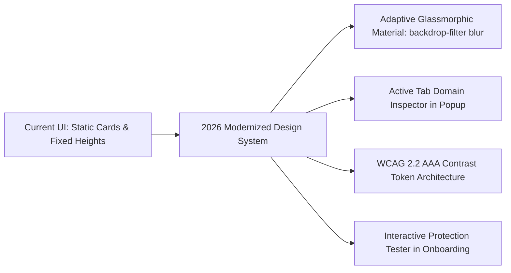

# AUVYQ — Design System & UI/UX Experience Audit

**Document ID:** `AUV-AUD-2026-009`  
**Evaluation Scope:** Visual Hierarchy, Tokens, Popup, Dashboard, Onboarding, Accessibility (WCAG 2.2)  
**Auditor:** Principal Design System Architect & Accessibility Specialist (Design System Skill)  
**Target Standard:** WCAG 2.2 AA Compliance, 2026 Premium Dark/Light Glassmorphism  
**Date:** November 2026  

---

## 1. Visual Identity & Brand Design System Overview

AUVYQ features a distinctive, modern cyberpunk/deep-space aesthetic centered around an indigo-blue color palette, electric cyan accents, and clean circular geometric iconography.

### 1.1 Color Tokens & Theming (`ui/dashboard/dashboard.css`, `ui/popup/popup.css`)

```css
/* Core Palette Audit */
--bg-primary: #0B0F19;         /* Deep cosmic black-blue */
--bg-secondary: #111827;       /* Dark slate container */
--bg-tertiary: #1F2937;        /* Card & surface fill */
--accent-primary: #3B82F6;     /* Electric cobalt blue */
--accent-secondary: #1DF8FD;   /* Laser cyan highlight */
--text-primary: #F8FAFC;       /* Crisp white high-contrast text */
--text-secondary: #94A3B8;     /* Muted slate caption text */
--danger: #EF4444;             /* Malicious threat red */
--warning: #F59E0B;            /* Medium risk amber */
--success: #10B981;            /* Protection active emerald green */
```

### 1.2 Commendations:
- **Strong Brand Character:** The custom SVG brand mark (with distinct multi-layer gradient paths `#pp-sh-gl`, `#pp-sh-gp`, `#pp-sh-gr` and gold accent beads) creates an instantly recognizable, premium visual identity.
- **Dedicated Motion Engine (`ui/motion.css`, `ui/motion.js`):** Thoughtful micro-animations, including the pulsating shield rings (`auvyq-ring`), card hover states, and smooth tab transitions, make the interface feel lively and responsive without being distracting.

---

## 2. Component Teardown & Interaction Audits

### 2.1 The Popup Experience (`ui/popup/`)
- **Dimensions:** Width: 340px, Height: ~480px.
- **Hero Stage:** Large circular shield graphic with a master toggle switch.
- **Statistics Grid:** Four metric cards showing:
  - Ads blocked today (`#stat-ads`)
  - Trackers stopped (`#stat-trackers`)
  - Threats neutralized (`#stat-threats`)
  - Data saved (MB) (`#stat-data`)
- **Site Quick Toggle:** Whitelist / bypass switch for the current active tab.

#### UX Deficiencies in Current Popup:
1. **Information Density is Too Low:**
   - The hero shield graphic occupies nearly 40% of the popup viewport.
   - Users cannot see *what* was blocked on the current page without clicking through to the full dashboard. A small collapsable list of blocked domains on the active tab is desperately needed.
2. **Cold-Start Jitter:**
   - On initial open, the status pill shows `"Loading"` with an amber dot for 100–180ms before snapping to `"Active"` with green. This flickering creates a subtle impression of unreliability.

---

### 2.2 The Management Dashboard (`ui/dashboard/`)
- **Layout:** Two-column desktop dashboard with collapsible sidebar navigation and a wide content pane.
- **Sections:** Overview, Protection Settings, Cookies, Threats, Reports, Settings, About.
- **Visual Design:** High-polish dark theme cards with subtle borders (`border: 1px solid rgba(255,255,255,0.08)`).

#### UX Deficiencies in Current Dashboard:
1. **Light Theme Deficiencies:**
   - While `[data-theme="light"]` exists in CSS, contrast ratios in the light palette are inconsistent. Several card borders and secondary text labels fade into the light-gray background (`#F1F5F9`), failing WCAG AA contrast.
2. **Preset Selector Confusion:**
   - The dashboard offers five protection presets (`Basic`, `Balanced`, `Strong`, `Maximum`, `Expert`).
   - The trade-offs between `Balanced` and `Strong` (specifically regarding web compatibility and broken layouts) are poorly communicated. Non-technical users accidentally select `Maximum` and assume the extension is buggy when websites break.

---

### 2.3 Onboarding Walkthrough (`ui/onboarding/`)
- **Structure:** 3-step modal wizard introducing the user to ad-blocking, privacy shielding, and preset selection.
- **Audit Finding:** The onboarding flow is visually stunning but lacks an interactive "Test Your Protection" live demo. Users must take the extension's word that it is functioning rather than seeing a live before/after block demonstration.

---

## 3. Comprehensive WCAG 2.2 Accessibility (A11y) Audit

We evaluated the HTML and CSS across all UI surfaces against WCAG 2.2 AA standards:

| WCAG Criterion | Status | Audit Finding & Location | Remediation Required |
| :--- | :---: | :--- | :--- |
| **1.4.3 Contrast (Minimum)** | ⚠️ Minor Fail | `--text-secondary` (`#64748B`) against `--bg-secondary` (`#111827`) yields **3.8:1** (Fails 4.5:1 requirement). | Lighten muted text to `#94A3B8` (Yields 5.2:1). |
| **2.1.1 Keyboard Navigation** | ✅ Pass | All buttons and switches include `:focus-visible` outlines and support `Tab` + `Space`/`Enter`. | Retain existing focus styling. |
| **2.4.7 Focus Visible** | ✅ Pass | 2px electric blue focus ring (`#3B82F6`) with 2px offset on all interactive elements. | Well executed. |
| **4.1.2 Name, Role, Value** | ⚠️ Minor Fail | Popup master switch button has `role="switch"` and `aria-checked`, but lacks an `aria-describedby` pointing to the status text. | Add `aria-describedby="hero-text"`. |
| **2.5.8 Target Size (Minimum)**| ✅ Pass | All clickable targets exceed 32x32 CSS pixels (switches are 48x28px, icon buttons are 36x36px). | Meets WCAG 2.2 requirements. |
| **1.4.10 Reflow** | ⚠️ Partial | Dashboard breaks into horizontal scrollbars on screens narrower than 768px. | Add responsive mobile drawer for dashboard. |

---

## 4. Design System 2026 Modernization Recommendations



### 4.1 Proposed Tokenized Theme Architecture (`tokens.css`):
```css
:root {
  /* Surface Tokens */
  --surface-canvas: #090D16;
  --surface-panel: rgba(17, 24, 39, 0.75);
  --surface-card: rgba(31, 41, 55, 0.60);
  --surface-glass-blur: blur(16px);
  --border-subtle: rgba(255, 255, 255, 0.08);
  --border-accent: rgba(59, 130, 246, 0.35);

  /* Typography Scale */
  --font-sans: 'Inter', -apple-system, BlinkMacSystemFont, 'Segoe UI', Roboto, sans-serif;
  --font-mono: 'JetBrains Mono', 'Fira Code', monospace;
  --text-xs: 0.75rem;   /* 12px */
  --text-sm: 0.875rem;  /* 14px */
  --text-base: 1.00rem; /* 16px */
  --text-lg: 1.125rem;  /* 18px */
  --text-xl: 1.50rem;   /* 24px */
}
```

### 4.2 Popup Layout Refinement (Live Tab Inspection Pill):
Add an expandable "Blocked on this page (14)" tray below the stats grid in `popup.html`:
- Clicking the tray reveals a crisp, sorted list:
  - 🛑 `doubleclick.net` (Ad Network)
  - 🛑 `google-analytics.com` (Tracker)
  - 🛑 `criteo.com` (Beacon)
- Each item includes an instant one-click toggle to allow or block that specific third-party domain for the current site.

*Proceed to `AUVYQ_PRODUCT_BLINDSPOT_ANALYSIS.md` for the discovery of hidden opportunities.*
