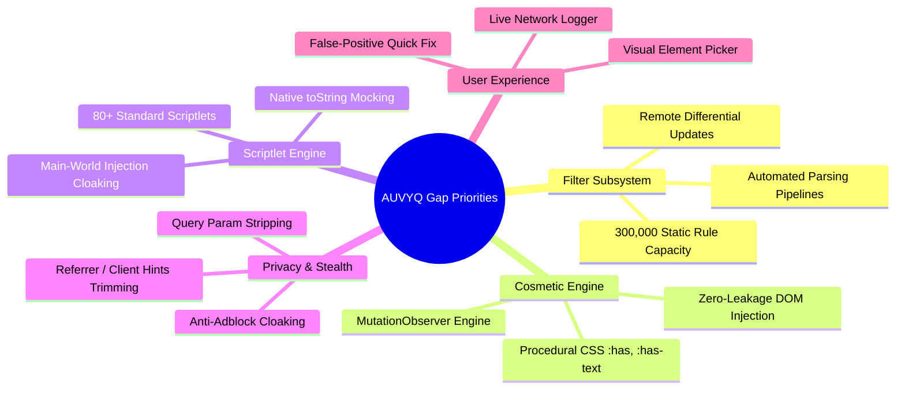

# AUVYQ — Feature Gap Analysis: Current vs. 2026 Competitive Standard

**Document ID:** `AUV-AUD-2026-004`  
**Evaluation Scope:** Complete Functional Comparison Matrix vs. Tier-1 Privacy Extensions  
**Competitor Benchmarks:** uBlock Origin / uBO Lite, AdGuard MV3, Brave Shields, Ghostery  
**Date:** November 2026  

---

## 1. Executive Capability Comparison Matrix

The table below rates AUVYQ v0.3.0 against modern competitive standards across all ad-blocking and privacy dimensions:

| Capability Domain | AUVYQ v0.3.0 | uBlock Origin Lite | AdGuard MV3 | Brave Shields | 2026 Parity Status |
| :--- | :---: | :---: | :---: | :---: | :--- |
| **Network Request Blocking** | ⚠️ Partial (217 rules) | ✅ Full (300k rules) | ✅ Full (300k rules) | ✅ Native C++ (Brave) | **CRITICAL GAP** |
| **Dynamic User Rule Capacity**| ⚠️ 4,500 capped | ✅ 30,000 rules | ✅ 30,000 rules | ⚠️ N/A | **HIGH GAP** |
| **Procedural Cosmetic Filtering**| ❌ None (Basic CSS only)| ✅ `:has()`, `:has-text`| ✅ Full Extended CSS| ✅ Extended CSS | **CRITICAL GAP** |
| **Scriptlet Library Depth** | ⚠️ 15 basic stubs | ✅ 85+ scriptlets | ✅ 90+ scriptlets | ✅ Procedural engine | **HIGH GAP** |
| **Zero-Leakage Anti-Adblock** | ❌ Trivial DOM leaks | ✅ Stealthed | ✅ Stealthed | ✅ Native C++ engine | **CRITICAL GAP** |
| **Interactive Element Picker** | ❌ Missing | ✅ Yes (Point & click) | ✅ Yes (Point & click)| ❌ No (Context menu) | **HIGH GAP** |
| **YouTube SSAI Defusal** | ❌ Generic CSS only | ✅ Dedicated engine | ✅ Dedicated engine | ✅ Custom rust filter | **CRITICAL GAP** |
| **Query Parameter Stripping** | ❌ Missing | ✅ Extensive list | ✅ Stealth Mode | ✅ Built-in debouncing| **HIGH GAP** |
| **CNAME Uncloaking** | ❌ Missing | ⚠️ Limited in MV3 | ✅ Via remote DoH | ✅ Native DNS layer | **MEDIUM GAP** |
| **Cookie Auto-Cleanup** | ⚠️ Basic header toggle| ❌ Static only | ✅ Cookie auto-purge | ✅ Ephemeral storage | **COMPETITIVE EDGE** |
| **Encrypted Backup Vault** | ✅ PBKDF2/AES-GCM | ❌ Plaintext JSON | ❌ Plaintext JSON | ❌ Sync engine only | **AUVYQ ADVANTAGE** |
| **Deterministic Heuristics**| ✅ Homoglyph/Typo | ❌ None | ❌ Third-party lists | ❌ Basic heuristic | **AUVYQ ADVANTAGE** |
| **Edge AI Threat Scoring** | ⚠️ Seam only (null) | ❌ None | ❌ None | ⚠️ Experimental | **STRATEGIC SEED** |

---

## 2. Detailed Technical Gap Breakdown

### 2.1 Network Filtering Engine

#### Current Implementation (`core/rule-parser/parser.ts`, `core/rule-compiler/compiler.ts`)
- Parses basic Adblock Plus syntax: `||domain.com^$script,third-party`, `@@||exception.com^`, and basic `##.selector`.
- Compiles rules into standard Chrome `declarativeNetRequest` JSON schema format.
- Validates regex patterns for RE2 compatibility.

#### Critical Missing Capabilities:
1. **Dynamic Query Parameter Stripping (`removeparam`):**
   - Modern tracking links embed unique identifiers in URL parameters (e.g., `?fbclid=`, `?gclid=`, `?utm_source=`, `?msclkid=`, `?mc_eid=`).
   - Standard DNR supports `action: { type: 'redirect', redirect: { transform: { queryTransform: { removeParams: [...] } } } }`.
   - AUVYQ currently lacks query parameter stripping, allowing tracking across domain boundaries.
2. **Header Neutralization & Modification (`modifyHeaders`):**
   - Incognito tracking exploits `Referer`, `User-Agent`, and `Sec-CH-UA` client hints.
   - AUVYQ does not use DNR `modifyHeaders` to strip or spoof tracking headers (`X-Client-Data`, `Referer: origin-when-cross-origin`).
3. **Response Redirect Redirection (`redirect: { extensionPath: '/resources/...' }`):**
   - High-performance ad blocking replaces blocked tracking scripts (e.g., Google Analytics, Tag Manager) with safe dummy scripts (`noop.js`, `1x1.gif`) so website logic does not crash.
   - AUVYQ ships `1x1.gif` and `noop.js` in `extension/resources/`, but only has 3 redirect rules configured across all static rulesets.

---

### 2.2 Cosmetic & Procedural DOM Filtering

#### Current Implementation (`content/cosmetic-injector.js`)
- Contains a hardcoded list of ~80 generic CSS selectors (`ins.adsbygoogle`, `amp-ad`, `.ad-banner`, `iframe[src*="doubleclick.net"]`).
- Injects a single `<style>` tag into the DOM head.
- Does not support DOM mutation re-checks or dynamic DOM queries.

#### Critical Missing Capabilities:
1. **Procedural CSS Selectors:**
   - Real-world modern ads wrap their banners in obfuscated, randomized class names (e.g., `
Sponsored
...

`).
   - Standard CSS selectors cannot hide these without procedural extensions:
     - `:has(> span:has-text(Sponsored))` (Parent matching)
     - `div:-abp-has(> a[href*="affiliate"])`
     - `:matches-path(/watch)` (Path-constrained cosmetic rules)
   - AUVYQ has **zero procedural selector engine**, leaving it helpless against modern Facebook, Reddit, X (Twitter), and news feed ads.
2. **MutationObserver TreeWalker:**
   - Single-Page Applications (SPAs like YouTube, React, Next.js sites) continuously hydrate new content into the DOM without page reloads.
   - AUVYQ's `cosmetic-injector.js` runs only once at `document_start`, failing to suppress late-rendered ads and infinite-scroll insertions.

---

### 2.3 Scriptlet Injection Engine

#### Current Implementation (`content/scriptlet-dispatch.js`, `core/scriptlet-engine/`)
- Contains an allowlist of 15 hardcoded scriptlets:
  `noop-callback`, `json-prune-lite`, `set-constant`, `prevent-addEventListener`, `prevent-setTimeout`, `noop-fetch`, `close-window`, `no-fetch-if`, `no-xhr-if`, `abort-on-property-read`, `hide-in-shadow`, `remove-class`, `remove-attr`, `prevent-eval-if`, `trusted-suppress-console`.

#### Critical Missing Capabilities:
1. **Scriptlet Library Breadth:**
   - uBlock Origin maintains over 85 battle-tested scriptlets. AdGuard maintains over 90.
   - Missing vital scriptlets: `abort-current-inline-script`, `xml-prune`, `webrtc-leak-protect`, `override-property-read`, `set-local-storage-item`, `spoof-css`.
2. **Anti-Defuser Stealth:**
   - Injected scriptlets can be detected if website scripts probe the property descriptors of overridden native methods (e.g., `Function.prototype.toString.call(window.fetch)` returning `"function fetch() { /* custom code */ }"` instead of `"function fetch() { [native code] }"`).
   - AUVYQ's implementations in `scriptlet-dispatch.js` do not mock native `toString()` signatures.

---

### 2.4 Video Ad Defusal (YouTube, Twitch, Streaming)

#### Current Implementation:
- AUVYQ relies purely on generic CSS rules (`#ad-overlay`, `.ad-container`) and standard network rules.

#### The Reality of 2026 Video Ads:
- YouTube and streaming providers employ Server-Side Ad Insertion (SSAI), dynamic chunk streaming, and player client integrity checks.
- If an ad blocker simply blocks network requests to ad endpoints, the video player throws error code `5000` or infinite buffering spinners.
- **Missing in AUVYQ:**
  - YouTube player response JSON patcher (`playerResponse.adPlacements = []`).
  - Video element rate accelerator (auto-skipping ad clips at 16x speed with audio muted).
  - Web Worker and `URL.createObjectURL` streaming interceptors.

---

### 2.5 User-Facing Interactive Tools

#### Current State:
- AUVYQ provides only a toggle switch, statistics cards, and settings sliders.

#### Missing Essential Tools:
1. **Interactive Visual Element Picker:**
   - Users cannot click on an annoying element on a page to permanently hide it. Every tier-1 ad blocker provides a point-and-click z-index highlight picker that compiles a custom CSS rule into user storage.
2. **Live Network Request Logger:**
   - When a website breaks, advanced users and filter creators need a live log of blocked vs. allowed requests, matching filter rules, and cosmetic hides. AUVYQ provides only post-hoc aggregate ring buffer counts.

---

## 3. Summary of Core Gaps to Close in 2026 Roadmap

*Proceed to `AUVYQ_SECURITY_PRIVACY_AUDIT.md` for the security and threat surface audit.*
