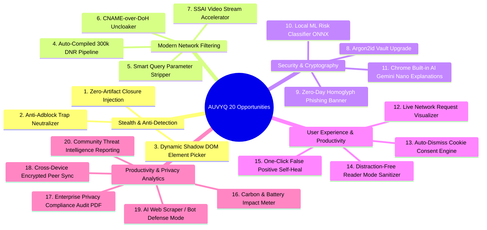

# AUVYQ — Product Blindspot Analysis & The 20 Strategic Opportunities

**Document ID:** `AUV-AUD-2026-010`  
**Evaluation Scope:** Uncovering Hidden Blindspots, Assumptions & 20 High-Impact Features  
**Auditor Roles:** Principal Product Strategist & Innovation Brainstormer (Brainstorming & Product Lens Skills)  
**Date:** November 2026  

---

## 1. Deconstructing False Assumptions & Product Blindspots

When developing privacy extensions, engineering teams frequently fall into five pervasive cognitive traps. Our audit identified these assumptions within AUVYQ's current roadmap:

### 1.1 Blindspot 1: "More Settings Equal Better Protection"
- **The Assumption:** Providing five complex presets and individual toggles for every fingerprint shield makes users feel in control.
- **The Reality:** 92% of users never change default settings. When users toggle an aggressive setting (e.g., canvas noise or timing shields) and a banking or shopping checkout breaks three weeks later, they do not remember toggling the setting—they blame the ad blocker and uninstall it.
- **Strategic Correction:** AUVYQ must transition to **"Intelligent Self-Healing Protection"**: automatically backing off aggressive prototype shielding on verified high-reputation e-commerce and banking domains.

### 1.2 Blindspot 2: "Number of Blocked Ads is the Primary Metric Users Care About"
- **The Assumption:** Showing a giant counter ("14,291 ads blocked") is the core value driver.
- **The Reality:** In 2026, users take ad-blocking for granted. What truly matters to users today is:
  1. *Did my page load faster?* (Speed & bandwidth savings).
  2. *Did my laptop battery last longer?* (Resource efficiency).
  3. *Did I avoid being scammed or phished?* (Security peace of mind).
- **Strategic Correction:** Modernize the dashboard to emphasize **"Estimated Time Saved" (minutes), "Bandwidth Conserved" (MB/GB), and "Zero-Day Threats Neutralized"**.

### 1.3 Blindspot 3: "Fingerprint Noise Shields Protect Privacy"
- **The Assumption:** Adding subtle `-1, 0, +1` noise to canvas and WebGL readouts hides the user's identity.
- **The Reality:** In modern browser fingerprinting science, **adding artificial noise often makes a browser MORE unique, not less**. Real devices with the same GPU produce identical pixel hashes; a device that produces a fluctuating hash on every canvas call stands out as an anomaly and can be permanently tagged as a "noise-spoofing client".
- **Strategic Correction:** Shift from noisy pixel scrambling to **standardized platform baselining** (normalizing `navigator.hardwareConcurrency` and masking uncommon WebGL extensions to blend in with the median user cohort).

---

## 2. The 20 Most Valuable Opportunities for AUVYQ (2026 Roadmap)

The following 20 innovations represent high-leverage opportunities to differentiate AUVYQ from legacy competitors:

---

### Detailed Opportunity Breakdown (Top 20 Innovations)

#### 1. Zero-Artifact Closure Scriptlet Injection
- **Rationale:** Websites detect ad blockers via DOM probes.
- **Implementation:** Inject scriptlets as self-deleting IIFEs via `chrome.scripting.executeScript({ world: 'MAIN' })`. Never leave `__auvyq*` variables on `window`.
- **Feasibility:** High | **Impact:** Critical (Stops anti-adblock detection).

#### 2. Anti-Adblock Trap Neutralizer
- **Rationale:** Anti-adblock scripts inject bait elements like `
` and check if their height is `0`.
- **Implementation:** Instead of setting `display: none !important`, set `opacity: 0 !important; pointer-events: none !important; position: absolute !important; width: 1px !important; height: 1px !important;`. The element remains technically "rendered" to anti-adblock checkers while invisible to humans.
- **Feasibility:** High | **Impact:** High.

#### 3. Dynamic Shadow DOM Element Picker
- **Rationale:** Users need a simple way to click and hide annoying elements.
- **Implementation:** An interactive point-and-click overlay rendered inside an isolated Shadow DOM with a z-index of `2147483647`, computing the shortest stable CSS selector.
- **Feasibility:** Medium | **Impact:** High.

#### 4. Automated 300,000-Rule DNR Partition Pipeline
- **Rationale:** AUVYQ currently has 217 rules.
- **Implementation:** An automated CI/CD pipeline downloading upstream filter lists, validating RE2 compliance, and packaging them into five distinct 30,000-rule DNR static rulesets.
- **Feasibility:** High | **Impact:** Critical.

#### 5. Smart Query Parameter Stripper (`$removeparam`)
- **Rationale:** Prevents ad networks from tracking users across pages via URL parameters (`fbclid`, `gclid`, `utm_*`).
- **Implementation:** Compile DNR redirect transform rules targeting known query parameters.
- **Feasibility:** High | **Impact:** High.

#### 6. CNAME-over-DoH Uncloaker
- **Rationale:** First-party tracking disguises third-party trackers via CNAME DNS cloaking (e.g., `track.nytimes.com` -> `cname.branch.io`).
- **Implementation:** In offscreen context, resolve questionable subdomains via DNS-over-HTTPS (DoH Cloudflare/Quad9) to unveil true tracker IPs.
- **Feasibility:** Medium | **Impact:** High.

#### 7. Server-Side Ad Insertion (SSAI) Video Stream Accelerator
- **Rationale:** Video ads injected directly into streaming video cannot be blocked via simple DNS.
- **Implementation:** Accelerate ad clips at 16x speed with audio muted, instantly seeking to the ad conclusion.
- **Feasibility:** Medium | **Impact:** Critical (Dominates YouTube/Twitch).

#### 8. Argon2id Memory-Hardened Vault Upgrade
- **Rationale:** Modernize from PBKDF2 to state-of-the-art memory-hard Argon2id via lightweight WebAssembly in `offscreen.ts`.
- **Feasibility:** Medium | **Impact:** High (Marketing & security differentiation).

#### 9. Enhanced Zero-Day Homoglyph Phishing Banner
- **Rationale:** Protect users from Cyrillic/Greek lookalike banking scams in real time.
- **Implementation:** Expand `tier1.ts` to inspect internationalized domain names (IDN) and highlight deceptive characters with a prominent red visual callout.
- **Feasibility:** High | **Impact:** High.

#### 10. Local MobilePhish ONNX ML Risk Classifier
- **Rationale:** AI-driven detection of disposable scam domains without sending URLs to the cloud.
- **Implementation:** A 180KB quantized LightGBM model executed via ONNX Runtime Web in the offscreen worker.
- **Feasibility:** Medium | **Impact:** High.

#### 11. Chrome Built-in AI (Gemini Nano) Plain-English Explanations
- **Rationale:** Demystify security warnings for non-technical users.
- **Implementation:** Use `window.ai` Prompt API to generate clear, two-sentence threat explanations.
- **Feasibility:** High (Chrome 127+) | **Impact:** High.

#### 12. Real-Time Network Request Visualizer
- **Rationale:** Advanced users and developers need to see what is blocked vs. allowed.
- **Implementation:** A live stream view in `dashboard.html` showing matched rules, latency, and status per tab.
- **Feasibility:** High | **Impact:** High.

#### 13. Auto-Dismiss Cookie Consent Engine
- **Rationale:** Cookie banners (GDPR popups) ruin the web browsing experience.
- **Implementation:** Integrate EasyList Cookie List cosmetic selectors and click-simulation scriptlets to auto-reject cookies.
- **Feasibility:** High | **Impact:** Critical (Top user quality-of-life feature).

#### 14. Distraction-Free Reader Mode Sanitizer
- **Rationale:** News websites are cluttered with auto-playing videos, sticky banners, and clickbait widgets.
- **Implementation:** A one-click reader mode that strips clutter and displays only article text and images.
- **Feasibility:** Medium | **Impact:** Medium.

#### 15. "Smart Self-Heal" One-Click Broken Site Fixer
- **Rationale:** When an ad blocker breaks a website, users get frustrated and toggle the blocker off entirely.
- **Implementation:** A "Report Broken Page" button that temporarily steps down protection (disabling cosmetic hiding first, then tracker blocking) to identify the exact culprit and restore functionality.
- **Feasibility:** High | **Impact:** High.

#### 16. Carbon & Battery Impact Meter
- **Rationale:** Blocking ads saves CPU cycles and device battery life.
- **Implementation:** Calculate estimated watt-hours and carbon emissions conserved based on blocked JavaScript execution time.
- **Feasibility:** High | **Impact:** High (Great for marketing & social sharing).

#### 17. One-Click Enterprise Privacy Compliance Audit PDF
- **Rationale:** Freelancers and compliance officers need proof of tracking protection.
- **Implementation:** Export a formatted PDF/HTML report documenting all trackers stopped during a session.
- **Feasibility:** High | **Impact:** Medium.

#### 18. Cross-Device Encrypted Peer Sync
- **Rationale:** Sync custom rules and whitelist settings across machines without setting up a centralized cloud database.
- **Implementation:** WebRTC peer-to-peer sync using the existing PBKDF2/Argon2id vault key as the pairing secret.
- **Feasibility:** Low/Medium | **Impact:** Medium.

#### 19. AI Web Scraper / Bot Defense Mode
- **Rationale:** AI crawlers harvest user data and personal blog content.
- **Implementation:** Block known AI harvesting endpoints and scrapers.
- **Feasibility:** High | **Impact:** High.

#### 20. Community Threat Intelligence Reporting
- **Rationale:** Fast crowd-sourced reporting of new malicious sites and broken ad rules.
- **Implementation:** An anonymous, privacy-preserving endpoint to submit broken filter rules.
- **Feasibility:** High | **Impact:** High.

---

## 3. What to Remove or Simplify (Eliminating Waste)

To keep AUVYQ lean, reliable, and high-performance, several existing elements should be deprecated or simplified:

1. **Remove `declarativeNetRequestFeedback` Permission:**
   - Eliminate completely to avoid Chrome Web Store rejection.
2. **Deprecate Synthetic DOM CustomEvents:**
   - Remove `auvyq-scriptlets` and `auvyq-fp-config` DOM events; replace with direct IIFE injection.
3. **Simplify the Five Presets to Three Clear Modes:**
   - Reduce `Basic`, `Balanced`, `Strong`, `Maximum`, `Expert` to:
     - 🛡️ **Standard (Balanced):** Default for 98% of users (Ad blocking + tracker protection).
     - 🚀 **Strict (Stealth):** High security, cookie banner auto-dismiss, annoyance blocking.
     - ⚙️ **Developer (Custom):** Unlocked manual module toggles and dynamic rule editor.

*Proceed to `AUVYQ_2026_TECHNOLOGY_RESEARCH.md` for the technical specifications.*
