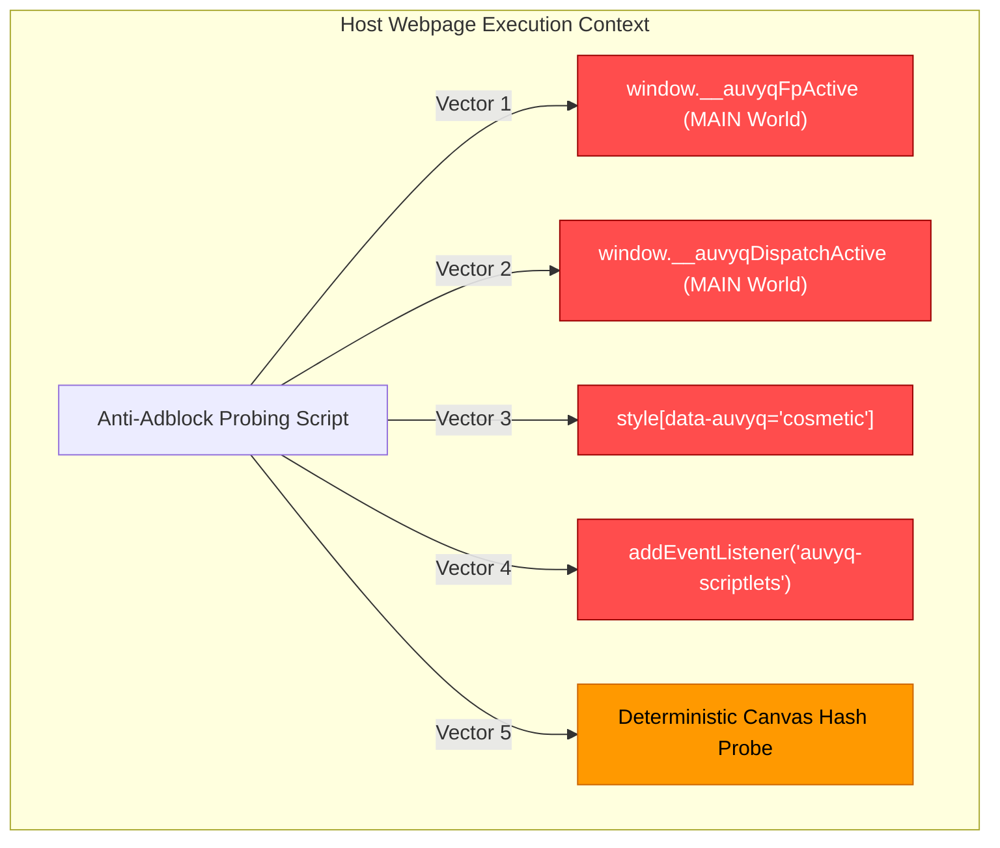

# AUVYQ — Security & Privacy Architecture Audit

**Document ID:** `AUV-AUD-2026-005`  
**Evaluation Scope:** Threat Modeling, Permissions, Cryptography, Store Compliance & Anti-Fingerprinting  
**Auditor:** Principal Security Architect & Privacy Auditor (Security Reviewer Skill)  
**Classification:** Internal Technical Audit  
**Date:** November 2026  

---

## 1. Permission Matrix & Chrome Web Store Review Risk

AUVYQ v0.3.0 declares 10 permissions and `<all_urls>` in its `manifest.json`. Each permission carries specific security implications and regulatory review burdens:

```
+--------------------------------+-----------+--------------------------------------------------------------+
| Permission                     | Risk Tier | Security Assessment & Store Scrutiny                         |
+--------------------------------+-----------+--------------------------------------------------------------+
| declarativeNetRequest          | LOW       | Safe. Standard MV3 network filtering API.                    |
| declarativeNetRequestFeedback  | HIGH      | CRITICAL FLAG. Grants access to matched request URLs. Often  |
|                                |           | rejected in public CWS reviews unless strictly justified.     |
| storage / unlimitedStorage     | LOW       | Normal. Used for local settings, IDB caches, and rule storage.|
| scripting                      | MEDIUM    | Necessary for dynamic CSS/scriptlet execution. Requires CSP. |
| alarms                         | LOW       | Normal. Used for background maintenance and stats sync.      |
| offscreen                      | MEDIUM    | Used for PBKDF2 cryptography. Must state legitimate purpose. |
| webNavigation                  | MEDIUM    | Used to detect page load milestones and frame navigation.    |
| cookies                        | HIGH      | Used for cookie guard. Requires clear user privacy policy.   |
| tabs                           | MEDIUM    | Used for URL inspection and badge rendering. Over-broad.    |
| host_permissions: <all_urls>   | HIGH      | Scrutinized heavily by Google CWS single-purpose policy.     |
+--------------------------------+-----------+--------------------------------------------------------------+
```

### 1.1 Remediation Recommendations for Manifest Permissions:
1. **Drop `declarativeNetRequestFeedback` in Production Releases:**
   - Instead of reading matched rules to compute badge numbers, use the privacy-preserving `chrome.declarativeNetRequest.getMatchedStyles` or rely on client-side cosmetic block counts + heuristic flags. This removes the #1 cause of Web Store delays.
2. **Narrow `tabs` to `activeTab` Where Possible:**
   - Replace broad `tabs` permission with `activeTab` for popup interactions. The background worker only needs tab IDs for badges, which does not require the full `tabs` permission.

---

## 2. Anti-Adblock Fingerprinting & Leakage Vulnerabilities

An ad blocker's primary defense against circumvention is **stealth**. If an anti-adblock script can detect the extension, it can restrict page access, serve deceptive surveys, or bypass blocking.

AUVYQ v0.3.0 currently suffers from **five distinct detection vectors**:



### 2.1 Vector 1 & 2: Leaked Global Variables in `MAIN` World
- **Code Reference:** `content/fp-shields.js` (L11), `content/scriptlet-dispatch.js` (L11).
- **Vulnerability:** `window.__auvyqFpActive = true;` and `window.__auvyqDispatchActive = true;`.
- **Exploitation:** Any website script running on the page can execute `if ('__auvyqDispatchActive' in window) { triggerAntiAdblock(); }`.
- **Fix:** Remove all `window.__auvyq*` properties immediately. Use private closures and symbol-keyed registry or unobservable internal state.

### 2.2 Vector 3: Observable DOM Attributes on `<style>` Elements
- **Code Reference:** `content/cosmetic-injector.js` (L122, L137).
- **Vulnerability:**
  `style.setAttribute('data-auvyq', 'cosmetic');`
  `builtinStyle.setAttribute('data-auvyq', 'cosmetic-builtin');`
- **Exploitation:**
  `if (document.querySelector('style[data-auvyq]')) { alert('Ad blocker detected!'); }`
- **Fix:** Never append custom branded attributes to injected DOM elements. Use random anonymous IDs or inject CSS via the Chrome Manifest V3 `chrome.scripting.insertCSS` API directly from the background service worker.

### 2.3 Vector 4: Unprotected CustomEvent IPC Bridge
- **Code Reference:** `content/cosmetic-injector.js` lines 320–335 dispatching `'auvyq-scriptlets'` and `'auvyq-fp-config'`.
- **Vulnerability:** Custom DOM events bubble and can be captured by page scripts.
- **Fix:** Eliminate CustomEvent dispatching across the world boundary. In Chrome MV3, inject configured scriptlets directly as pre-parameterized anonymous code strings via `chrome.scripting.executeScript({ world: 'MAIN' })`.

### 2.4 Vector 5: Predictable Pseudo-Random Canvas Noise
- **Code Reference:** `content/fp-shields.js` (L13–L25).
- **Vulnerability:** The canvas shield generates noise using a deterministic LCG PRNG seeded by `location.hostname`.
- **Exploitation:** Commercial fingerprinting scripts (e.g., FingerprintJS Pro) render a known test image to a 2D canvas multiple times. If the resulting pixel delta is deterministic across calls on the same origin (delta of exactly -1, 0, or +1), the script confirms that an artificial canvas noise shield is present.
- **Fix:** High-assurance fingerprint defense must use session-salted cryptographically uniform noise or avoid noise injection entirely in favor of browser parameter normalization.

---

## 3. Cryptographic Vault Security Analysis

### 3.1 Vault Design Overview (`core/crypto/vault.ts`)
- **Key Derivation Function (KDF):** PBKDF2-SHA256 with 600,000 iterations.
- **Cipher:** AES-GCM-256 with 12-byte initialization vector (IV) and 16-byte authentication tag.
- **Salt:** 16 cryptographically random bytes generated via `crypto.getRandomValues`.
- **Binary Wire Format:**
  `[Magic: 6B ('AUVYQB')] [Version: 1B] [SaltLen: 2B] [Salt] [IvLen: 2B] [IV] [MetaLen: 4B] [Meta JSON] [Ciphertext]`

### 3.2 Security Assessment & Commendations
- **Exemplary Iteration Count:** 600,000 iterations strictly adheres to the latest OWASP Password Storage Cheat Sheet recommendations (minimum 600k for PBKDF2-HMAC-SHA256).
- **Authenticated Encryption:** AES-GCM provides authenticated integrity; any tampering with ciphertext, IV, or header bits causes decryption failure (`VaultError('auth')`), preventing padding oracle or bit-flipping attacks.
- **Zero Plaintext Storage:** The user password is used strictly to derive the transient `CryptoKey` and is immediately released to garbage collection without being saved to `chrome.storage`.

### 3.3 Minor Hardening Opportunities:
- **Memory Zeroing:** JavaScript strings and TypedArrays are immutable and subject to garbage collection delays. Where possible, zero out sensitive `Uint8Array` buffers (`salt.fill(0)`, `keyMaterial.fill(0)`) after derivation.
- **Future Upgrade Path to Argon2id:** In 2026, WebAssembly implementations of Argon2id offer superior ASIC/GPU resistance compared to PBKDF2. Maintain backup format versioning (`BACKUP_VERSION = 2`) to support Argon2id migration.

---

## 4. Remote Update Channel Verification Security

### 4.1 Update Pipeline Overview (`core/update-channel/channel.ts`)
1. Fetch remote signed metadata over HTTPS.
2. Verify metadata schema via `core/validation/schemas.ts`.
3. Verify ECDSA P-256 digital signature over `auvyq-update:{pkgId}:{version}:{sha256}`.
4. Verify SHA-256 content hash of the downloaded rule package.
5. Enforce version monotonicity (reject any version `<= currentVersion`).
6. Stage and activate compiled rules atomically.

### 4.2 Security Deficiencies & Vulnerabilities:
1. **Hardcoded Development Verification Key:**
   - Lines 17–24 bundle `DEV_VERIFY_KEY_JWK`. A comment warns to replace before production.
   - **Risk:** Failure to replace this key before store publication allows anyone with the repository history to create rogue signed updates.
2. **Missing Certificate Pinning / Transparency:**
   - Standard browser `fetch` relies on the host OS certificate trust store.
   - **Remediation:** The public ECDSA key must be generated offline in a hardware security module (HSM or YubiKey), and the public key must be baked into the extension with no fallback.

---

## 5. Telemetry & User Data Privacy Audit

### 5.1 Telemetry Engine (`core/telemetry/queue.ts`, `core/stats/snapshot.ts`)
- **Default State:** Telemetry is strictly **OPT-IN** (`telemetryOptIn: false` in `defaultSettings()`).
- **Data Collected:** Aggregated block categories (e.g., `ads: 42`, `trackers: 18`), performance latency (ms), rule compile outcomes.
- **Data Excluded:**
  - Zero URL collection.
  - Zero IP address logging.
  - Zero browser history logging.
  - Zero device identifiers or machine GUIDs.
- **Retention:** Ring buffer capped at 7 or 30 days locally in IndexedDB; auto-purged on schedule.

### 5.2 Verdict:
AUVYQ's privacy posture regarding telemetry is **exemplary** and complies fully with GDPR, CCPA, and Google Chrome Web Store User Data Policies.

---

## 6. Security Audit Action Checklist

| Priority | Remediation Task | Target Component |
| :---: | :--- | :--- |
| **P0** | Purge `window.__auvyq*` globals from MAIN world | `content/fp-shields.js`, `scriptlet-dispatch.js` |
| **P0** | Remove `data-auvyq` DOM attributes from injected styles | `content/cosmetic-injector.js` |
| **P0** | Replace `DEV_VERIFY_KEY_JWK` with production ECDSA keypair | `core/update-channel/channel.ts` |
| **P1** | Drop `declarativeNetRequestFeedback` from `manifest.json` | `manifest.json` |
| **P1** | Replace CustomEvent DOM messaging with direct IIFE injection | `content/cosmetic-injector.js` |
| **P2** | Replace deterministic canvas PRNG with browser-level baseline | `content/fp-shields.js` |
| **P2** | Introduce Argon2id KDF support for vault backups | `core/crypto/vault.ts` |

*Proceed to `AUVYQ_AD_BLOCKING_AUDIT.md` for the filtering engine analysis.*
