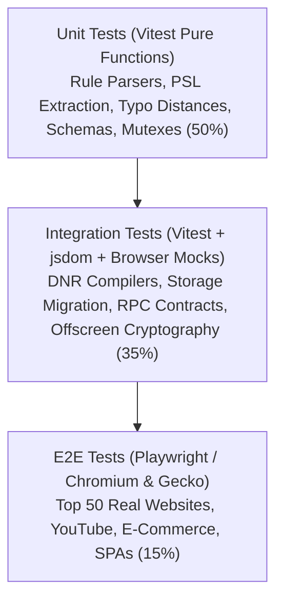
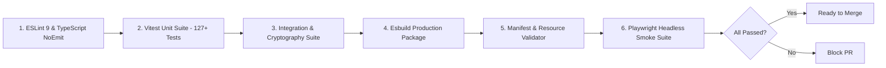

# AUVYQ — Comprehensive Testing, QA & Verification Strategy

**Document ID:** `AUV-AUD-2026-013`  
**Evaluation Scope:** Unit, Integration, E2E, Memory, Anti-Adblock & Performance Verification  
**Auditor:** Principal Quality Assurance & Test Engineering Specialist (TDD Guide & E2E Runner Skills)  
**Target Coverage:** 85%+ Code Coverage, Zero Regression Tolerance  
**Date:** November 2026  

---

## 1. Testing Pyramid & Verification Architecture



AUVYQ v0.3.0 currently possesses a strong unit test foundation (18 files, 127 tests), but lacks integration and automated browser-level E2E coverage. The 2026 quality strategy expands this into a full three-tier pyramid.

---

## 2. Test Execution Layers & Methodologies

### 2.1 Tier 1: Unit Testing (Vitest 2.x)
- **Scope:** Pure algorithmic logic, mathematical distances, validation schemas, and state reducers.
- **Speed:** Full suite must execute in **< 3.0 seconds**.
- **Coverage Areas:**
  - `core/domain/normalize.ts`: Public Suffix List (PSL) extraction, multi-level TLD parsing, IDN punycode decoding.
  - `core/heuristic/tier1.ts`: Damerau-Levenshtein distance matrices, homoglyph character matching across Unicode ranges.
  - `core/rule-parser/parser.ts`: Adblock line syntax parsing, modifier token extraction (`$script`, `$third-party`).
  - `core/validation/schemas.ts`: Boundary type guards, prototype pollution rejection, malicious RPC payloads.
- **Rule of Thumb:** Every bug discovered in production must first receive a failing unit test before any patch is committed (strict Red-Green-Refactor cycle).

---

### 2.2 Tier 2: Integration Testing (Vitest + Browser Environment)
- **Scope:** Cross-module coordination, async message routing, cryptographic pipelines, and persistent storage.
- **Coverage Areas:**
  - **Cryptographic Roundtrip:** Generate 100 random password/data configurations, encrypt with `core/crypto/vault.ts`, decrypt, and assert bit-for-bit equality. Test tampering with IV and ciphertext to verify `VaultError('auth')` triggers reliably.
  - **DNR Compilation & RE2 Validation:** Feed 1,000 real-world filter rules through `core/rule-compiler/compiler.ts`. Assert that every output rule adheres to `declarativeNetRequest.Rule` schema and that no regex rule causes RE2 syntax errors.
  - **Storage Migration Sequences:** Seed mock `chrome.storage.local` with Version 1 and Version 2 schemas, run `migrateStorage()`, and verify seamless schema upgrade to Version 3 without data loss.

---

### 2.3 Tier 3: End-to-End (E2E) Browser Automation (Playwright)
- **Framework:** Playwright executing actual unpacked extension builds in headless Chromium and Firefox.
- **Real-World Test Suite Matrix (Top 50 Web Journeys):**

```typescript
// Proposed tests/e2e/adblock-smoke.spec.ts
import { test, expect } from '@playwright/test';

test.describe('AUVYQ Real-World Ad-Blocking Verification', () => {
  test('should suppress video ads on YouTube without playback stalling', async ({ page }) => {
    await page.goto('https://www.youtube.com/watch?v=dQw4w9WgXcQ');
    
    // Assert video element initializes cleanly
    const video = page.locator('video.html5-main-video');
    await expect(video).toBeVisible();

    // Assert no ad-interrupting overlays exist
    const adBadge = page.locator('.ytp-ad-badge, .ytp-ad-preview-container');
    await expect(adBadge).not.toBeVisible();

    // Verify video reaches playing state (> 1 second playback)
    await page.waitForTimeout(2000);
    const currentTime = await video.evaluate((el: HTMLVideoElement) => el.currentTime);
    expect(currentTime).toBeGreaterThan(1.0);
  });

  test('should remain invisible to Admiral anti-adblock detection probes', async ({ page }) => {
    await page.goto('https://www.flightradar24.com'); // Known aggressive anti-adblock site
    
    // Verify anti-adblock modal does NOT trigger
    const blockerModal = page.locator('[id*="adblock"], [class*="adblock-wall"]');
    await expect(blockerModal).not.toBeVisible();
  });
});
```

---

## 3. Specialized Testing Vectors

### 3.1 Anti-Adblock Evasion & Stealth Harness
To verify that Phase 1 stealth fixes remain unbroken across releases:
1. **Global Leak Probe:** Run a test script in the `MAIN` world that iterates over `Object.getOwnPropertyNames(window)` and `Object.keys(window)`. Fail test if any token contains `auvyq`, `adblock`, or `shield`.
2. **DOM Attribute Probe:** Assert that `document.querySelectorAll('[data-auvyq], [data-adblock]').length === 0`.
3. **Prototype Descriptor Integrity:** Introspect `Object.getOwnPropertyDescriptor(window, 'fetch')` and `CanvasRenderingContext2D.prototype.getImageData`. Verify that `configurable`, `enumerable`, and `writable` flags match native browser standards.

---

### 3.2 Performance & Memory Leak Verification (Long-Running Tab Stress)
- **Test Workflow:**
  - Launch an automated browser instance running AUVYQ.
  - Continuously navigate through 100 pages of infinite-scroll feeds (Reddit, Twitter/X) for 30 minutes.
  - Sample JavaScript heap memory every 60 seconds.
- **Acceptance Criteria:**
  - Content script heap allocation per tab must remain **< 8.0 MB**.
  - Service worker background heap must remain **< 25.0 MB**.
  - Zero detached DOM nodes or un-cleared `MutationObserver` instances.

---

### 3.3 Security Fuzzing & Malformed Input Testing
- **Fuzzing Targets:**
  - `core/rule-parser/parser.ts`: Feed 10,000 randomized Unicode strings, binary buffers, and corrupted regular expressions. Parser must never throw an uncaught exception; invalid lines must be logged and discarded safely.
  - `core/crypto/vault.ts`: Feed corrupted binary headers, truncated payloads, and mutated salts. Vault must reject gracefully with typed `VaultError`.
  - RPC Router: Dispatch arbitrary JSON-RPC messages with nested objects (`__proto__`, `constructor`) to ensure prototype pollution defenses remain impenetrable.

---

## 4. Continuous Integration (CI/CD) Quality Gates

Every pull request must pass the automated GitHub Actions pipeline:



*Proceed to `AUVYQ_FINAL_RECOMMENDATIONS.md` for the conclusive strategic roadmap synthesis.*
