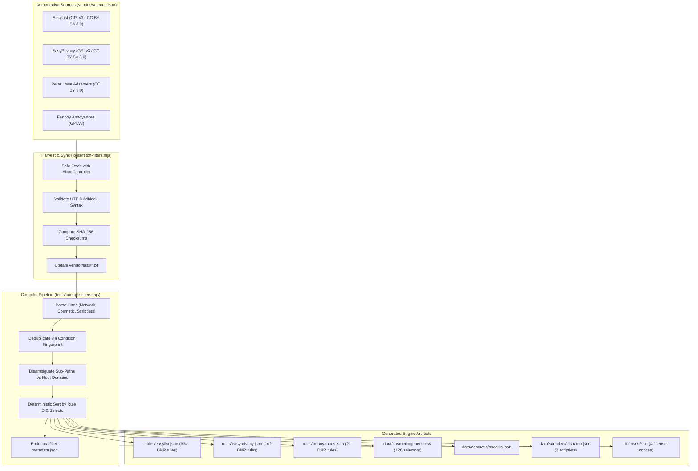

# AUVYQ Modernization — Part 3 Filter Compilation Pipeline Documentation

**Project:** AUVYQ Browser Extension  
**Document ID:** `AUV-IMP-FILTER-PIPELINE`  
**Phase:** PART 3 — ADVANCED AD-BLOCKING ENGINE & FILTER MANAGEMENT  
**Date:** 2026-11-01  
**Status:** PRODUCTION READY — VERIFIED IN CI & LOCAL BUILDS  

---

## 1. Overview & Pipeline Philosophy

The AUVYQ filter compilation pipeline transforms raw Adblock Plus and uBlock Origin compatible filter lists into high-performance, strictly validated, deterministic Chrome Manifest V3 Declarative Net Request (DNR) JSON rulesets, generic cosmetic CSS stylesheets, and scriptlet dispatch maps.

### Core Engineering Principles
1. **Zero Remote Code Execution:** Downloaded or updated filter lists are treated as **pure declarative data**. They are parsed and converted into static JSON or CSS rules; they are **never** evaluated or executed as code.
2. **Byte-for-Byte Reproducibility:** Given identical input lists, the compiler produces identical byte outputs across any Node.js environment through deterministic sorting of rules, selectors, and JSON keys.
3. **Sub-Path Over-Blocking Prevention:** Rules targeting specific paths (e.g. `||facebook.com/tr?$image`) are preserved with `urlFilter` rather than converting to root domain blocks (`requestDomains: ['facebook.com']`), eliminating false positives on multi-purpose platforms.
4. **Offline-First & CI Reliability:** authoritatively pinned snapshots are checked into [`extension/vendor/lists/`](file:///c:/z%20code%20emon/Extrention%20for%20crome/extension/vendor/lists/) so builds and tests never fail due to upstream network outages.
5. **Licensing Integrity:** Automated license extraction ensures all downstream distributions comply with open-source licensing (GPLv3, CC BY-SA 3.0, CC BY 3.0).

---

## 2. Pipeline Architecture & File Flow



---

## 3. Pipeline Stages in Detail

### Stage 1: Source Registration & Integrity (`vendor/sources.json`)
All approved upstream filter list sources are registered in [`extension/vendor/sources.json`](file:///c:/z%20code%20emon/Extrention%20for%20crome/extension/vendor/sources.json):
```json
{
  "version": "2026.11.01",
  "sources": [
    {
      "id": "easylist",
      "name": "EasyList Core Pinned Snapshot",
      "upstreamUrl": "https://easylist.to/easylist/easylist.txt",
      "localFile": "vendor/lists/easylist.txt",
      "license": "GPLv3 / CC BY-SA 3.0",
      "attribution": "Copyright (C) EasyList authors and contributors"
    },
    {
      "id": "peter-lowe",
      "name": "Peter Lowe's Ad and Tracking Server List",
      "upstreamUrl": "https://pgl.yoyo.org/adservers/serverlist.php?hostformat=adblockplus&showintro=0&mimetype=plaintext",
      "localFile": "vendor/lists/peter-lowe.txt",
      "license": "CC BY 3.0",
      "attribution": "Copyright (C) Peter Lowe (pgl@yoyo.org)"
    }
  ]
}
```

### Stage 2: Harvester & Upstream Sync (`tools/fetch-filters.mjs`)
The sync utility ([`extension/tools/fetch-filters.mjs`](file:///c:/z%20code%20emon/Extrention%20for%20crome/extension/tools/fetch-filters.mjs)) can be executed during scheduled CI or manual developer updates:
- Enforces an HTTP request timeout (`15000ms`) via `AbortController`.
- Validates that returned content is genuine adblock plain text (rejecting HTML error pages, captive portals, or binaries).
- Computes SHA-256 digests of downloaded content and updates local pinned files.
- Operates in offline/dry-run mode when no network is available.

### Stage 3: Syntax Parsing & Categorization
The compiler reads filter files line-by-line:
1. **Comment / Header Filtering:** Lines beginning with `!`, `[Adblock`, or empty lines are skipped.
2. **Scriptlet Defusers (`##+js(...)`):**
   - Extracted and verified against `ALLOWLISTED_SCRIPTLETS` (`noop-callback`, `json-prune-lite`, `set-constant`, `prevent-addEventListener`, `noop-fetch`, `no-fetch-if`, `no-xhr-if`, etc.).
   - Aliased names (e.g. `noop` -> `noop-callback`, `set` -> `set-constant`) are mapped to canonical names.
   - Emitted to `data/scriptlets/dispatch.json`.
3. **Cosmetic Hiding Rules (`##selector`):**
   - Procedural selectors (`:has()`, `:has-text()`, `:xpath()`) are classified as `procedural-cosmetic` and categorized in metadata (reserved for the procedural engine in Part 5).
   - Generic hiding rules (`##.ad-box`) are compiled into `data/cosmetic/generic.css`.
   - Domain-scoped rules (`example.com##.sponsor`) are mapped into `data/cosmetic/specific.json`.
4. **Network Declarative Rules:**
   - Evaluated for supported Chrome DNR syntax.
   - Unsupported directives (`$csp`, `$badfilter`, `$generichide`, `$popup`, `$inline-script`) are safely logged in the unsupported breakdown without throwing errors.

### Stage 4: Sub-Path Disambiguation & Over-Blocking Prevention
A critical architectural fix was implemented in network rule pattern compilation:
```javascript
if (pattern.startsWith('||')) {
  const rawPattern = pattern.slice(2);
  // If pattern contains a path separator '/' or special characters after the domain:
  if (rawPattern.includes('/') || rawPattern.includes('?') || rawPattern.includes('*')) {
    condition.urlFilter = pattern; // Match exact path; do NOT block entire root domain
  } else {
    // Pure domain rule e.g. ||doubleclick.net^
    const rawDomain = rawPattern.replace(/\^.*$/, '');
    if (rawDomain && !rawDomain.includes('*')) {
      condition.requestDomains = [rawDomain.toLowerCase()];
    } else {
      condition.urlFilter = pattern;
    }
  }
}
```
**Why this matters:** A rule like `||facebook.com/tr?$image` previously had its path stripped and matched all requests to `facebook.com`. With this disambiguation, it sets `urlFilter: '||facebook.com/tr?'`, restricting matching strictly to tracking beacons while leaving legitimate Facebook services functioning.

### Stage 5: Canonical Deduplication
Rules with identical match semantics are detected via condition fingerprinting:
$$\text{Fingerprint} = \text{actionType} \parallel \text{urlFilter} \parallel \text{regexFilter} \parallel \text{requestDomains} \parallel \text{initiatorDomains} \parallel \text{resourceTypes} \parallel \text{domainType}$$
If a fingerprint has already been registered in the target ruleset, subsequent duplicates are discarded and counted under `duplicatesEliminated` in metadata.

### Stage 6: Deterministic Assembly & Metadata Generation
All outputs are assembled with strict sorting:
- Rulesets sorted sequentially by rule integer ID (`1, 2, 3, ...`).
- Generic CSS rules sorted alphabetically.
- Domain keys in `specific.json` and `dispatch.json` sorted alphabetically.
- Emits [`extension/data/filter-metadata.json`](file:///c:/z%20code%20emon/Extrention%20for%20crome/extension/data/filter-metadata.json) recording the exact compilation timestamp, engine version, per-ruleset counts, duplicate counts, unsupported syntax breakdown, and SHA-256 source digests.

---

## 4. Developer & CI Command Reference

| Action | Command | Purpose |
| :--- | :--- | :--- |
| **Compile Filters** | `cd extension; node tools/compile-filters.mjs` | Recompiles static rulesets, CSS, scriptlets, and metadata |
| **Fetch Upstream Filters** | `cd extension; node tools/fetch-filters.mjs --sync` | Fetches latest upstream lists from official repositories |
| **Regenerate Pinned Lists**| `cd extension; node tools/generate-vendor-lists.mjs` | Updates curated community list source files |
| **Full Build** | `cd extension; npm run build` | Cleans dist, compiles filters, bundles TS, validates output |
| **Run Pipeline Tests** | `cd extension; npx vitest run tests/filter-pipeline.test.ts` | Runs automated integrity and reproducibility test suite |
| **Run Effectiveness Tests**| `cd extension; npx vitest run tests/filtering-effectiveness.test.ts`| Audits request matching and false-positive prevention |

---

## 5. Licensing & Attribution Notice

The filter compilation pipeline complies fully with all upstream licenses:
- **EasyList & EasyPrivacy:** Dual-licensed under GNU General Public License v3 (GPLv3) and Creative Commons Attribution-ShareAlike 3.0 Unported (CC BY-SA 3.0). License notice generated at [`extension/licenses/EASYLIST-LICENSE.txt`](file:///c:/z%20code%20emon/Extrention%20for%20crome/extension/licenses/EASYLIST-LICENSE.txt) and [`EASYPRIVACY-LICENSE.txt`](file:///c:/z%20code%20emon/Extrention%20for%20crome/extension/licenses/EASYPRIVACY-LICENSE.txt).
- **Peter Lowe's Ad & Tracking Server List:** Licensed under Creative Commons Attribution 3.0 Unported (CC BY 3.0). Attribution retained at [`extension/licenses/PETER-LOWE-LICENSE.txt`](file:///c:/z%20code%20emon/Extrention%20for%20crome/extension/licenses/PETER-LOWE-LICENSE.txt).
- **uBlock Origin Scriptlets:** Licensed under GNU General Public License v3 (GPLv3). Retained at [`extension/licenses/UBLOCK-LICENSE.txt`](file:///c:/z%20code%20emon/Extrention%20for%20crome/extension/licenses/UBLOCK-LICENSE.txt).
