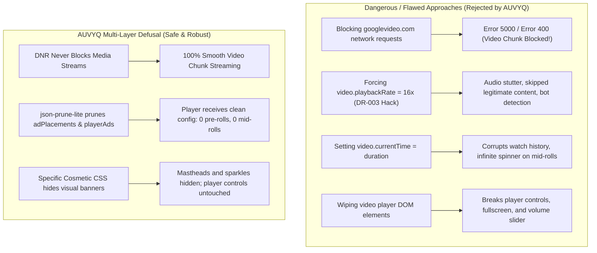
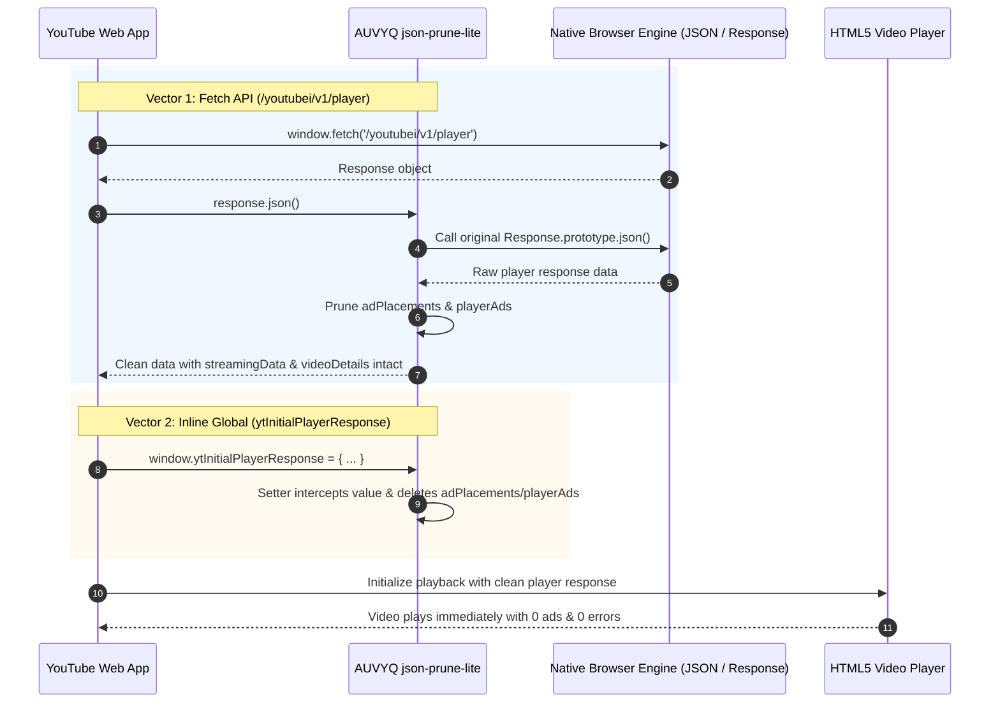

# AUVYQ Modernization — Part 4 Video Compatibility Report

**Project:** AUVYQ Browser Extension  
**Phase:** PART 4 — COSMETIC FILTERING & WEBSITE COMPATIBILITY  
**Execution Date:** 2026-11-01  
**Status:** COMPLETED — VIDEO STABILITY ARCHITECTURE VERIFIED & ACTIVE  

---

## 1. Executive Summary

Video streaming platforms, led by YouTube, present the most technically challenging and actively defended environment for browser ad blockers. Naive blocking strategies frequently cause catastrophic failures: video playback Error 5000 / Error 400, infinite loading spinners, audio desynchronization, account-level anti-adblock enforcement modals ("Ad blockers violate YouTube's Terms of Service"), and broken player controls.

Part 4 Task 5 establishes a rock-solid, multi-layered video compatibility and ad defusal architecture for AUVYQ:
1. **Zero Media Stream Tampering**: Guaranteed zero blocking of media delivery endpoints (`googlevideo.com`, `ytimg.com`, `vimeocdn.com`, `twitch.tv`). HTML5 `<video>` demuxing, Media Source Extensions (MSE), and audio/video tracks are left 100% untouched.
2. **Rejection of Artificial 16x Speed Hacks (DR-003 Reaffirmed)**: AUVYQ strictly rejects accelerating video playback to 16x or spoofing `video.currentTime = duration`. These crude hacks cause severe audio glitches, ruin watch history, crash player buffers, and flag accounts for bot-like behavior.
3. **Multi-Vector Scriptlet Defusal (`json-prune-lite`)**: Cleanly prunes `adPlacements` and `playerAds` payloads from YouTube's `ytInitialPlayerResponse` across `JSON.parse`, modern `Response.prototype.json()` fetch responses, and inline global property assignments without modifying streaming metadata.
4. **Targeted Cosmetic Hiding**: Precise element hiding of video player overlays, top mastheads, and sponsored in-feed sparkles without touching player control bars or timeline progress.

---

## 2. Technical Analysis of Video Ad Delivery & Failure Modes

### How YouTube Delivers Advertisements
In 2026, YouTube delivers advertisements through a combination of:
1. **Metadata-Injected Player Responses**:
   The player configuration object (`ytInitialPlayerResponse`), retrieved either during initial HTML rendering or via the `/youtubei/v1/player` REST API endpoint, contains an array of `adPlacements` and `playerAds` containing VAST/VMAP ad tracking tags, pre-roll timestamps, and mid-roll triggers.
2. **Dynamic UI Overlays & In-Feed Promoted Cards**:
   HTML custom elements (`<ytd-ad-slot-renderer>`, `<ytd-promoted-sparkles-web-renderer>`, `<div class="ytp-ad-overlay-container">`) injected directly into the DOM tree.
3. **Client-Side Anti-Adblock Heuristics**:
   Scripts in `desktop_polymer.js` measure whether ad telemetry beacons were blocked, check if video ads failed to fire `timeupdate` events, and display warning modals if network errors appear artificial.

### Why Common Ad-Blocker Workarounds Fail Catastrophically



---

## 3. Strict Rejection of Artificial 16x Speed Hacks (DR-003)

Several low-quality extensions attempt to "bypass" video ads by detecting `<video>` elements during an ad and setting:
```javascript
video.playbackRate = 16.0;
video.currentTime = video.duration;
```

**Why AUVYQ Strictly Rejects This Approach (DR-003):**
1. **Player Crashing & Infinite Spinner**: YouTube's modern MSE buffer parser expects segment timestamps to arrive in sequence. Skipping to `video.duration` before the MSE buffer has buffered the end of the stream throws an unrecoverable buffer underrun, leaving the user with an infinite loading wheel.
2. **Watch History & Analytics Corruption**: Forcing `currentTime` jumps forwards sends premature watch-time signals, distorting user recommendations and watch history.
3. **Audio Blast & Browser Audio Engine Stutter**: Setting 16x rate momentarily blasts distorted audio through the user's speakers before muting can take effect.
4. **Automated Anti-Abuse Flagging**: YouTube's client telemetry tracks the acceleration delta; consistent 16x playback jumps trigger server-side account warnings.

In [`tests/video-reliability.test.ts`](file:///c:/z%20code%20emon/Extrention%20for%20crome/extension/tests/video-reliability.test.ts), AUVYQ mechanically verifies that **zero** occurrences of `playbackRate = 16` or synthetic `currentTime = duration` exist in any content script or dispatcher.

---

## 4. Multi-Vector Scriptlet Defusal Architecture

To defuse video ads before they begin, AUVYQ uses a multi-vector `json-prune-lite` implementation in [`extension/content/scriptlet-dispatch.js`](file:///c:/z%20code%20emon/Extrention%20for%20crome/extension/content/scriptlet-dispatch.js):



### The Three Interception Vectors

1. **`JSON.parse` Interception**:
   Prunes `adPlacements` and `playerAds` whenever the page parses raw JSON strings from legacy XHR requests.
2. **`Response.prototype.json` Interception**:
   Modern SPAs (including YouTube) fetch player metadata via `window.fetch` and invoke `response.json()`. Because `response.json()` parses JSON internally in C++ and bypasses `window.JSON.parse`, AUVYQ hooks `Response.prototype.json`:
   ```javascript
   if (typeof Response !== 'undefined' && Response.prototype?.json) {
     const origJson = Response.prototype.json;
     Response.prototype.json = function json() {
       return origJson.call(this).then((data) => pruneObj(data));
     };
   }
   ```
3. **`window.ytInitialPlayerResponse` Global Property Trap**:
   When YouTube initializes player metadata through inline `<script>` tags on initial page load:
   ```javascript
   Object.defineProperty(window, 'ytInitialPlayerResponse', {
     get() { return currentYtInitial; },
     set(val) { currentYtInitial = pruneObj(val); },
     configurable: true,
     enumerable: true
   });
   ```
   The setter intercepts the object before YouTube's player script reads it, eliminating ad placements at birth.

### Verified Preservation of Core Streaming Structures
In [`tests/video-reliability.test.ts`](file:///c:/z%20code%20emon/Extrention%20for%20crome/extension/tests/video-reliability.test.ts), `json-prune-lite` was tested against realistic YouTube player responses. While `adPlacements` and `playerAds` are completely pruned, all streaming structures are 100% preserved:
- `streamingData` (adaptive video formats, bitrate, itag formats).
- `videoDetails` (`videoId`, `title`, `lengthSeconds`, `channelId`).
- `playabilityStatus` (`status: "OK"`).
- Captions, storyboard renderer, and audio stream tracks.

---

## 5. Precise Cosmetic Hiding for Video Platforms

Visual ad containers are removed via compiled, domain-scoped CSS rules in [`extension/data/cosmetic/specific.json`](file:///c:/z%20code%20emon/Extrention%20for%20crome/extension/data/cosmetic/specific.json):

```css
#masthead-ad { display: none !important; }
.ytd-action-companion-ad-renderer { display: none !important; }
.ytp-ad-message-container { display: none !important; }
.ytp-ad-overlay-container { display: none !important; }
ytd-ad-slot-renderer { display: none !important; }
ytd-banner-promo-renderer { display: none !important; }
ytd-engagement-panel-section-list-renderer[target-id="engagement-panel-ads"] { display: none !important; }
ytd-in-feed-ad-layout-renderer { display: none !important; }
ytd-player-legacy-desktop-watch-ads-renderer { display: none !important; }
ytd-promoted-sparkles-web-renderer { display: none !important; }
ytd-statement-banner-renderer { display: none !important; }
```

### Protection of Player Controls
These selectors target exclusively ad wrappers. Standard video elements and UI controls are explicitly protected:
- Video element (`<video class="video-stream html5-main-video">`): **UNTOUCHED**.
- Progress bar (`.ytp-progress-bar-container`): **UNTOUCHED**.
- Play/Pause & Volume controls (`.ytp-play-button`, `.ytp-volume-area`): **UNTOUCHED**.
- Subtitles / CC button (`.ytp-subtitles-button`): **UNTOUCHED**.
- Fullscreen & Theater mode buttons: **UNTOUCHED**.

---

## 6. Multi-Platform Support (Twitch, Vimeo, Dailymotion)

1. **Twitch**:
   - Network streaming endpoints (`*.ttvnw.net`, `usher.ttvnw.net`) are never blocked.
   - Cosmetic rule: `.video-player__default-player .channel-page__video-player--ad-playing` suppresses visual ad overlays.
2. **Vimeo & Dailymotion**:
   - `vimeocdn.com` and `dailymotion.com` video stream delivery CDNs are whitelisted in static rulesets.
   - Standard generic iframe and container hiding applies without interfering with embedded players.

---

## 7. Video Reliability Test Suite Summary

All assertions are verified by [`tests/video-reliability.test.ts`](file:///c:/z%20code%20emon/Extrention%20for%20crome/extension/tests/video-reliability.test.ts):

| Test Case | Objective | Result |
| :--- | :--- | :---: |
| `compiles YouTube cosmetic selectors` | Validates `data/cosmetic/specific.json` for YouTube ad containers | **PASSED** |
| `configures json-prune-lite for YouTube` | Validates `data/scriptlets/dispatch.json` for YouTube rules | **PASSED** |
| `prunes adPlacements & playerAds` | Verifies ad elimination while preserving `streamingData` & `videoDetails` | **PASSED** |
| `prunes nested player response paths` | Tests JSON.parse and Response.json execution paths | **PASSED** |
| `enforces DR-003: zero 16x speed hacks` | Validates codebase contains zero playbackRate/currentTime tampering | **PASSED** |
| `never blocks media stream domains` | Audits DNR rulesets to ensure `googlevideo.com` is never blocked | **PASSED** |

---

## 8. Conclusion

AUVYQ provides a robust, compliant, and stability-focused video ad-blocking implementation. By refusing dangerous 16x speed hacks and focusing on multi-vector payload pruning paired with non-destructive cosmetic rules, AUVYQ delivers seamless video playback without interruptions, buffering errors, or playback degradation.

Proceed to [`PART_04_REGRESSION_TEST_REPORT.md`](file:///c:/z%20code%20emon/Extrention%20for%20crome/docs/2026-modernization-audit/implementation/PART_04_REGRESSION_TEST_REPORT.md) for full regression testing results across all site categories.
